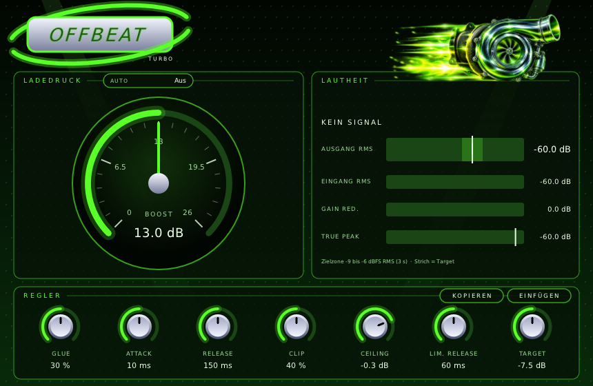

# Offbeat Turbo

**Master-Lautheit für Hard Bounce:** Glue-Kompressor → Soft-Clipper → True-Peak-sicherer Limiter. Der große Ladedruck-Regler macht den Mix laut, die Anzeige zeigt, ob der Drop in der Zielzone liegt. Teil der [Offbeat-Familie](https://github.com/lukestark-glitch/offbeat).



| Formate | Systeme | Lizenz |
|---|---|---|
| VST3 · VST2 · AU · CLAP · LV2 · **LADSPA** (für LMMS) | macOS (Intel + Apple Silicon) · Windows · Linux | ISC (frei nutzbar) |

## Inhalt

- [Was kann Offbeat Turbo?](#was-kann-offbeat-turbo)
- [Installation](#installation)
- [So benutzt du Turbo](#so-benutzt-du-turbo)
- [Alle Regler](#alle-regler)
- [Einstellungen als JSON](#einstellungen-als-json-kopieren--einfügen)
- [Presets zum Kopieren](#presets-zum-kopieren)
- [Lautheit messen: turbo-render](#lautheit-messen-turbo-render)
- [Selbst bauen und anpassen](#selbst-bauen-und-anpassen)

## Was kann Offbeat Turbo?

**Ziel** aus Hard-Bounce-Referenzen: im Drop **−6 bis −9 dBFS RMS**, Spitzen knapp unter 0 (**Ceiling −0,3 dBTP**).

1. **Boost (Ladedruck):** fährt den Mix in die Kette, mehr Boost = lauter.
2. **Glue:** leichter Bus-Kompressor, stereo gekoppelt, mit weichem Knie. Er hält den Mix zusammen und gleicht die Hälfte seiner Absenkung automatisch aus.
3. **Clip:** Soft-Clipper kurz unter dem Ceiling. Er holt Lautheit über Sättigung statt über Pumpen.
4. **Limiter:** schaut 1,5 ms voraus und sucht Spitzen auf 4-fach überabgetastetem Signal. Er ist **True-Peak-sicher**, auch die Spitzen zwischen den Samples bleiben unter dem Ceiling.
5. **Auto (optional):** regelt langsam auf die Ziellautheit nach und friert in Breakdowns ein.

Außerdem:
- **Anzeige:** Ausgang-RMS mit Zielzone, Eingang-RMS, Gain-Reduction und True-Peak.
- **Latenz:** 1,6 ms, wird der DAW gemeldet.
- **Presets:** 4 Stück.
- **LADSPA-Version für den LMMS-Master.**
- **Offline-Werkzeug** zum Messen fertiger Exporte.

## Installation

**Kurz:** Lade unter [Releases](https://github.com/lukestark-glitch/offbeat-turbo/releases) das ZIP für dein System, kopiere das passende Format in den Plugin-Ordner und lass deine DAW neu scannen. Turbo gehört als **letzter Effekt auf den Master**.

| System | VST3 | AU | CLAP |
|---|---|---|---|
| macOS | `~/Library/Audio/Plug-Ins/VST3/` | `~/Library/Audio/Plug-Ins/Components/` | `~/Library/Audio/Plug-Ins/CLAP/` |
| Windows | `C:\Program Files\Common Files\VST3\` | – | `C:\Program Files\Common Files\CLAP\` |
| Linux | `~/.vst3/` | – | `~/.clap/` |

**LMMS:** Die Datei `offbeat-turbo-ladspa.dylib` (macOS) bzw. `.dll`/`.so` in den LADSPA-Ordner von LMMS legen. Den Ordner findest du unter Einstellungen → Pfade, z. B. `~/Documents/lmms/plugins/ladspa/`. **Unter macOS muss sie auf `.so` enden**, also umbenennen in `offbeat-turbo-ladspa.so`. Danach im FX-Mixer (F9) beim **Master** „Add effect“ → „Offbeat Turbo“. LADSPA zeigt nur einfache Regler, ohne Anzeige.

Ausführlich für alle Systeme und DAWs: **[Setup-Anleitung](https://github.com/lukestark-glitch/offbeat/blob/main/SETUP.md)**.

## So benutzt du Turbo

**Manuell (Standard):**
1. Turbo als letzten Effekt auf den Master legen.
2. Den lautesten Teil (Drop) abspielen.
3. **Boost** drehen, bis der Balken *Ausgang RMS* in der grünen Zielzone steht.
4. Auf die Anzeige achten:
   - **Gain Reduction** dauerhaft über etwa 6 dB heißt: zu viel. Dann lieber den Mix selbst lauter machen.
   - **Clip** hoch: mehr Sättigung statt Limiter-Pumpen.

**Auto:**
1. Den Schalter **Auto** in der Kopfzeile von LADEDRUCK einschalten.
2. Turbo regelt den Ausgang langsam auf **Target**, um höchstens 1,5 dB pro Sekunde und maximal ±12 dB um den Boost.
3. In Stille und in Breakdowns friert Auto ein. Als Breakdown gilt: Der Eingang liegt mehr als 10 dB unter seinem jüngsten Maximum. So bleibt der Breakdown leiser als der Drop.

**Bedienung** wie bei allen Offbeat-Plugins:
- ziehen (Shift = fein), Mausrad, Doppelklick = Standard,
- Klick auf den Wert = Zahl eintippen,
- KOPIEREN/EINFÜGEN als JSON.

## Alle Regler

| Regler | Bereich | Standard | Was er verändert | Beispiel |
|---|---|---|---|---|
| Boost (Ladedruck) | 0 … +26 dB | +13 dB | wie stark der Mix in Glue, Clipper und Limiter gefahren wird; mehr = lauter | Mix mit −16 dBFS RMS → etwa +13 dB für −7,5 dBFS |
| Auto | Aus / An | Aus | An: regelt zusätzlich zum Boost langsam auf Target | an, wenn die Lautheit von selbst stimmen soll |
| Glue | 0 … 60 % | 30 % | leichter Bus-Kompressor: Schwelle −6 … −14 dBFS, Ratio bis 2,8:1 | 10 % für offener, 50 % für „dichter“ |
| Attack | 1 … 19 ms | 10 ms | wie schnell Glue greift | 3 ms bändigt auch die Kick, 15 ms lässt sie durch |
| Release | 20 … 280 ms | 150 ms | wie schnell Glue loslässt | 80 ms für mehr Pumpen im Takt |
| Clip | 0 … 80 % | 40 % | Soft-Clipper: Einsatz bis 4,8 dB unter dem Ceiling | 60 % für „Hart −6“, 0 % für ganz sauber |
| Ceiling | −1,2 … 0 dB | −0,3 dB | höchster Pegel am Ausgang (True-Peak) | −1,0 dB, wenn der Track später als MP3/AAC hochgeladen wird |
| Lim. Release | 10 … 110 ms | 60 ms | wie schnell der Limiter loslässt; kurz = lauter, lang = ruhiger | 30 ms für mehr Lautheit, 100 ms für weniger Verzerrung |
| Target | −11 … −4 dB | −7,5 dB | Ziellautheit: Strich in der Anzeige; mit Auto regelt Turbo darauf | −6 dB für sehr laut, −9 dB für dynamischer |

**Anzeige** (nur VST3/AU/CLAP/LV2):

| Balken | Bedeutung |
|---|---|
| Ausgang RMS | Lautheit über 3 s; grüne Zone −9 … −6 dBFS, Strich = Target |
| Eingang RMS | Lautheit vor Turbo |
| Gain Red. | wie viel Glue und Limiter zusammen absenken |
| True Peak | höchste Spitze der letzten 3 s, Strich = Ceiling |

Mit Auto steht unten links die aktuelle Auto-Verstärkung („AUTO +3,2 dB“).

Die Bereiche sind so gewählt, dass LMMS beim Einfügen der LADSPA-Version genau die Standardwerte einstellt. LADSPA kennt nur grobe Standard-Stufen; `make check` prüft das.

## Einstellungen als JSON (KOPIEREN / EINFÜGEN)

KOPIEREN gibt alle Regler als JSON aus, EINFÜGEN setzt alle genannten.

```json
{ "boost": 15, "clip": 0.6, "target": -6, "auto": true }
```

- **Schlüssel:** `boost` `glue` `comp_attack` `comp_release` `clip` `ceiling` `lim_release` `target` `auto`
- **%-Regler** stehen als 0 … 1 (`"glue": 0.3` = 30 %).
- **Schalter** als `true`/`false`.
- **Anzeige-Werte** (`out_rms`, …) lassen sich nicht setzen.

Das Offline-Werkzeug versteht dasselbe: `bin/turbo-render --in song.wav --json turbo.json`.

## Presets zum Kopieren

Die Presets sind auf einen Mix mit etwa **−16 dBFS RMS** abgestimmt. Ist dein Mix lauter oder leiser, passt du Boost an oder schaltest Auto ein.

<details><summary><b>1. Drop -7.5 (Standard)</b></summary>

```json
{
  "boost": 13,
  "glue": 0.3,
  "comp_attack": 10,
  "comp_release": 150,
  "clip": 0.4,
  "ceiling": -0.3,
  "lim_release": 60,
  "target": -7.5,
  "auto": false
}
```

</details>
<details><summary><b>2. Sanft -9</b></summary>

```json
{
  "boost": 8.5,
  "glue": 0.2,
  "comp_attack": 10,
  "comp_release": 150,
  "clip": 0.25,
  "ceiling": -0.3,
  "lim_release": 60,
  "target": -9,
  "auto": false
}
```

</details>
<details><summary><b>3. Hart -6</b></summary>

```json
{
  "boost": 15,
  "glue": 0.2,
  "comp_attack": 10,
  "comp_release": 150,
  "clip": 0.6,
  "ceiling": -0.3,
  "lim_release": 60,
  "target": -6,
  "auto": false
}
```

</details>
<details><summary><b>4. Nur Limiter</b></summary>

```json
{
  "boost": 0,
  "glue": 0,
  "comp_attack": 10,
  "comp_release": 150,
  "clip": 0,
  "ceiling": -0.3,
  "lim_release": 60,
  "target": -7.5,
  "auto": false
}
```

</details>

## Lautheit messen: turbo-render

Exportiere deinen Song als WAV und miss ihn vor und nach Turbo:

```sh
bin/turbo-render --in song.wav                         # Standard-Preset
bin/turbo-render --in song.wav --preset 2 --out master.wav
bin/turbo-render --in song.wav --set boost=10 --set auto=1
```

Ausgegeben werden RMS gesamt, das lauteste 3-s-Fenster (≈ „RMS im Drop“), Sample-Peak und True-Peak, jeweils vorher und nachher. Mit `--out` wird die bearbeitete WAV geschrieben (die Latenz ist schon herausgerechnet).

> Beim Rendern mit LMMS über die Kommandozeile (`lmms render`) `-x 1` angeben. Sonst rechnet LMMS 2-fach überabgetastet, und beim Herunterrechnen entstehen Spitzen über dem Ceiling.

## Selbst bauen und anpassen

```sh
git clone --recurse-submodules https://github.com/lukestark-glitch/offbeat-turbo
cd offbeat-turbo
make          # alle Formate (inkl. LADSPA) nach bin/ + turbo-render
make check    # Test-Drop, Grenzfälle, True-Peak, Latenz, LMMS-Standardwerte prüfen
make install  # macOS: Plug-Ins-Ordner + LADSPA auch in den LMMS-Ordner (als .so)
```

Windows/Linux: siehe [Setup-Anleitung](https://github.com/lukestark-glitch/offbeat/blob/main/SETUP.md#5-selbst-bauen). Aufbau des Codes: **[docs/CODE.md](docs/CODE.md)**.

## Lizenz

[ISC](LICENSE): Du darfst den Code und die Plugins frei nutzen, verändern und weitergeben, auch kommerziell.
